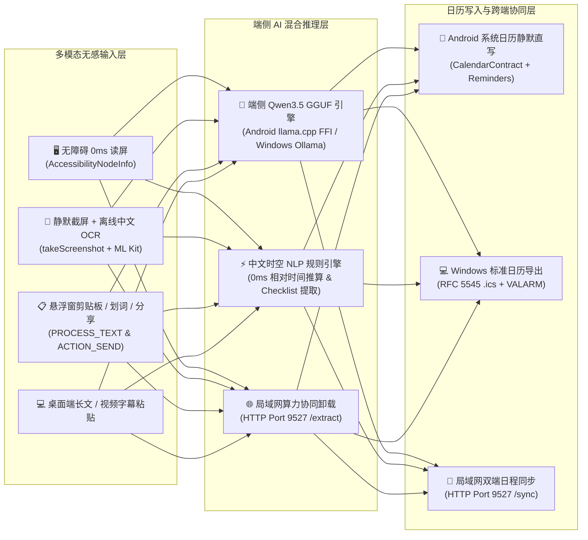

# ⚡ 知程 (Anno2Agenda)

> **端侧 AI 驱动的跨端无感通知转日程与智能提醒助手 (Android + Windows)**  
> *On-Device AI-Powered Cross-Platform Announcement-to-Agenda Assistant*

**知程 (Anno2Agenda)** 是一款专为解决高校教务通知、竞赛群消息、学术海报、线上会议长文中**“关键日程节点极易遗漏、手动录入日历繁琐、云端上传存在隐私泄露风险”**而打造的开源端侧 AI 应用。

基于 **Flutter (Android + Windows)** 构建，融合 **端侧小语言模型 (`Qwen3.5` GGUF + `llama.cpp`)**、**零延迟中文时空规则引擎**、**Android 无障碍 0ms 读屏** 与 **Google ML Kit 离线中文 OCR**，实现从“看到通知”到“静默写入系统日历并设置闹钟提醒”的全链路断网可用、零跳转闭环。

---

## ✨ 核心特性 (Key Features)

### 1. 📱 Android 零跳转原地悬浮窗 & 全场景无感采集
无需在微信/QQ/飞书与日历 App 之间反复切换，贴边半透明「⚡知程」胶囊在当前屏幕上方**原地展开操作卡片**：
* **🖥️ 0ms 无障碍直读屏幕 (`AccessibilityService`)**：直接遍历当前窗口 UI 节点树提取微信群聊、公众号推文、网页通知文本，**0 延迟、0 耗电、免 OCR**。
* **📸 静默截屏 + 离线中文 OCR**：针对海报图片或 Canvas 渲染页面，自动隐藏悬浮窗并调用 Android 11+ `takeScreenshot()` 静默截屏，交由内置 **Google ML Kit Chinese OCR** 离线识别图片文字。
* **📋 焦点切换剪贴板读取**：利用悬浮卡焦点切换机制完美适配 Android 10–16 剪贴板读取限制。
* **⚡ 悬浮窗内提前预热大模型**：可在悬浮卡内直接点击「⚡ 预热模型」，提前加载权重至手机 RAM，避免有输入时才等待冷启动。
* **✂️ 系统级划词直达与分享接管**：注册 `ACTION_PROCESS_TEXT` 与 `ACTION_SEND`，在任意 App 选中文字点击「提取日程」或「分享 -> 知程」即可一键唤起解析。

### 2. 🧠 端侧双引擎 AI 解析 & 极简交互
* **顶部极简双状态控件 (红/黄/绿)**：
  * **解析引擎状态**：🔴 红色未启动（支持**长按控件直接启动/预热大模型**，点击查看运行详情）；🟡 黄色正在启动；🟢 绿色就绪常驻。
  * **悬浮窗权限状态**：🔴 红色未开启（点击一键开启/授权）；🟢 绿色运行就绪。
* **底部三项沉浸式 Dock 栏**：
  * **AI 提取**：紧凑通知投喂区，标题右侧精巧**演示小图标**一键填充预置通知示例。
  * **我的日程**：本地时间轴与系统日历同步状态管理。
  * **设置**：深度模型预热控制、空闲自动释放内存时长、深度思考模式（Think Mode）开关、局域网协同与无障碍服务全配置。
* **精细化内存释放与思考模式控制**：
  * **空闲自动卸载**：支持设置无任务 1/3/5/10 分钟或永不释放，自动解除大模型在 RAM 中的常驻，杜绝被手机系统杀后台。
  * **思考模式开关 (Think Mode)**：关闭时 1 秒直出 JSON 日程（推荐）；开启时大模型将输出完整思维链后再输出日程，应对复杂长文逻辑。
* **内置端侧 GGUF 大模型推理**：
  * **Android 端**：集成 `llama.cpp` (`b8201` 原生支持 `Qwen3.5` Gated DeltaNet 混合架构 + `Vulkan` GPU 加速)，支持直接在手机本地加载运行 `Qwen3.5-0.8B` / `Qwen3.5-2B` GGUF 模型。
  * **Windows 端**：自动检测并静默拉起本机 `Ollama` 或 `llama-server` 守护进程，自动绕过系统代理直连本地推理接口。
* **内置模型中心**：预置阿里云魔搭社区国内高速直链，支持一键断点续传下载、模型设为默认、删除卸载与缓存清理。
* **0ms 中文时空语义规则引擎兜底**：毫秒级解析相对日期、会议号、地点与待办 Checklist。

### 3. 📅 一键静默直写系统日历
* **Android 端 (`CalendarContract`)**：通过原生 `ContentResolver` 直接静默写入系统日历数据库并自动配置提前提醒闹钟（`Reminders`），若设备无日历账户自动初始化本地日历账户，支持在悬浮窗内原地一键入库。
* **Windows 端 (`RFC 5545 .ics`)**：一键生成包含 `VALARM` 提醒的标准 `.ics` 日历文件（保存在 `exported_ics/` 目录），并自动唤起 Windows 系统日历（Outlook / Windows Calendar）导入。

### 4. 🌐 局域网无云端同步与跨端算力协同 (Port `9527`)
* **双向日程合并 (`/sync`)**：手机与电脑处于同一局域网（Wi-Fi / 手机热点）时，输入对端 IP 即可毫秒级完成日程双向去重合并，全程数据不出内网。
* **手机投喂 · 电脑推理 (`/extract`)**：当手机端配置了对端 Windows IP 时，可将长篇教务通知卸载至桌面端大模型高速解析并回传结构化 JSON。

### 5. 🖥️ 沉浸式 AI 推理过程全量可视化终端 (Inference Visualizer & Terminal)
彻底消除端侧大模型推理过程中的“黑盒盲等”与死机疑虑，带来极客级别的透明体验：
* **实时 Token 流式打字机**：Android 端 `llama.cpp` 原生生成流或桌面端 HTTP 流式吐字实时渲染，附带平滑呼吸光标 `▌`，见证 AI 逐词思考与生成。
* **推理速率与耗时实时仪表盘**：动态统计生成 Token 数量、推理耗时（精确至 0.1s）及实时推理速度（tokens/s），模型性能与设备算力一目了然。
* **全流程阶段语法高亮日志**：分类呈现 `[初始化]`、`[路由]`、`[模式]`、`[后处理]`、`[规则引擎]` 与 `[完成]` 各环节底层细节。
* **深色控制台设计与收起/展开**：采用深色 Slate 终端风格（点缀 macOS 经典三色指示点），支持一键折叠/展开，既满足极客探究欲，又兼顾整洁日常使用。

---

## 🏗️ 系统架构与工作流 (Architecture)



---

## 📂 项目目录结构 (Directory Structure)

```text
announcement2agenda/
├── lib/
│   ├── main.dart                          # 响应式三栏/双栏/移动端工作台 UI、模型管家弹窗、悬浮窗引导面板
│   ├── models/
│   │   └── agenda_event.dart              # 日程结构化数据模型与 RFC 5545 (.ics) 序列化生成
│   └── services/
│       ├── ai_extractor_service.dart      # 端侧大模型 (Android LlamaController / 桌面 HTTP) + 时空规则双引擎
│       ├── local_model_manager.dart       # 魔搭 ModelScope 断点续传下载、模型删除、推理引擎生命周期管理
│       ├── lan_sync_service.dart          # 端口 9527 局域网双向日程同步 (/sync) 与算力卸载 (/extract) 服务
│       └── platform_bridge.dart           # Flutter <-> Android MethodChannel 跨平台通信桥接
├── android/app/src/main/
│   ├── AndroidManifest.xml                # 权限声明、划词/分享 Intent Filter、悬浮窗与无障碍服务注册
│   ├── res/xml/accessibility_service_config.xml # 无障碍节点读取与 Android 11+ 静默截屏能力配置
│   └── kotlin/com/anno2agenda/anno2agenda/
│       ├── MainActivity.kt                # Flutter 引擎通道、权限申请、悬浮窗后台 AI 解析桥接
│       ├── FloatingBubbleService.kt       # 零跳转原地展开全局悬浮窗（读屏 / 截屏OCR / 剪贴板 / 原地写日历）
│       ├── ScreenCaptureAccessibilityService.kt # 0ms 屏幕文字提取 + 静默截屏 + ML Kit 离线中文 OCR
│       └── CalendarWriterHelper.kt        # Android CalendarContract 原生日历与闹钟提醒静默写入工具
├── windows/                               # Windows 桌面端 C++ 宿主工程
└── test/
    └── widget_test.dart                   # 多日程解析准确性测试与多分辨率响应式布局防溢出测试
```

---

## 🚀 快速开始与编译指南 (Getting Started)

### 环境要求
* **Flutter SDK**：`>= 3.24.0`（推荐 `3.47.x` Stable）
* **Android 编译环境**：JDK 17+、Android SDK Platform 35、Android NDK（用于编译 `llama.cpp` 原生 C++ 与 Vulkan 算子）
* **Windows 编译环境**：Visual Studio 2022（勾选「使用 C++ 的桌面开发」工作负载）

### 1. 获取依赖与运行测试
```powershell
flutter pub get
flutter analyze
flutter test
```

### 2. 编译或运行 Windows 桌面版
```powershell
# 直接调试运行 Windows 桌面端
flutter run -d windows

# 编译 Windows Release 发行版
flutter build windows --release
```
> 编译产物位于：`build\windows\x64\runner\Release\`

### 3. 编译 Android 安装包 (APK)
> 💡 **提示**：若开发机开启了全局系统代理（`HTTP_PROXY`），建议在执行 Gradle 打包前临时清空代理环境变量，以确保国内镜像与本地守护进程顺畅连接：
```powershell
$env:HTTP_PROXY=""; $env:HTTPS_PROXY=""; $env:ALL_PROXY=""
flutter build apk --release --split-per-abi
```
生成的分架构安装包位于 `build\app\outputs\flutter-apk\`：
* **`app-arm64-v8a-release.apk`（推荐，约 35.6 MB）**：适用于所有主流 64 位 Android 真机，已内嵌 `llama.cpp` 端侧推理动态库与 `Google ML Kit` 离线中文 OCR。
* **`app-armeabi-v7a-release.apk`**：适用于旧款 32 位 ARM 设备。
* **`app-x86_64-release.apk`**：适用于 PC 端 Android 模拟器。

---

## 📖 使用指南 (Usage Guide)

### Android 端「零跳转悬浮窗」使用流程
1. 打开 App，进入底部导航栏 **「悬浮窗与模型」** 页面。
2. 点击 **「开启无障碍识屏/截屏权限」**，在系统无障碍设置中开启 **「知程 AI 识屏与静默截屏助手」**。
3. 点击 **「开启零跳转全局悬浮窗」** 并授予悬浮窗权限，屏幕右侧将出现 **「⚡知程」** 贴边胶囊。
4. 切换到微信群通知、网页公告或活动海报界面，点击 **「⚡知程」** 原地展开悬浮卡片：
   * 普通文字界面 $\rightarrow$ 点击 **「🖥️ 读屏幕文字」**（0ms 直读，无需截屏）
   * 图片海报界面 $\rightarrow$ 点击 **「📸 截屏 OCR」**（自动收起悬浮窗静默截屏并离线识别中文）
   * 已复制文本 $\rightarrow$ 点击 **「📋 读剪贴板」**
5. 悬浮卡片将直接在当前界面下方列出提取出的结构化日程，点击 **「📅 一键静默写入系统日历」** 即可完成入库并自动收起悬浮窗。

### 端侧大模型管理
1. 点击顶部导航栏右侧的 **「模型管家」**。
2. 选择预置的 **`Qwen3.5-0.8B (移动端极速版)`** 或 **`Qwen3.5-2B (全能多模态增强版)`** 点击 **「一键下载并自动配置」**。
3. 下载完成后自动挂载激活；若不再使用某模型，随时可在弹窗内点击 **「删除模型」** 彻底释放存储空间。

---

## 📄 开源协议 (License)

本项目基于 **MIT License** 开源，欢迎提交 Issue 与 Pull Request 共同完善端侧 AI 日程生态。
