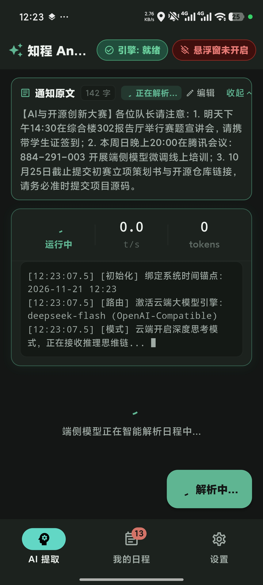
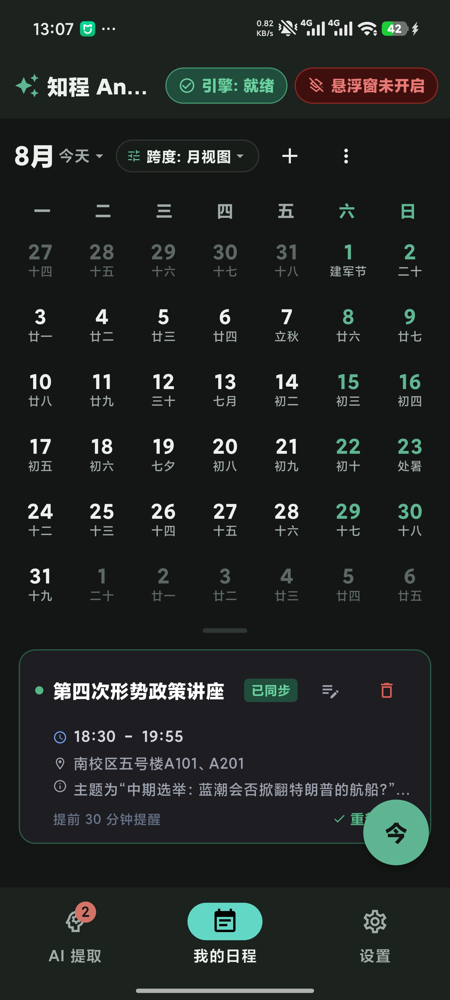

  
  <h1>知程 (MeetSync / Anno2Agenda)</h1>
  

    <strong>端云协同 AI 驱动的跨端无感通知转日程与智能提醒助手 (Android + Windows)</strong> 
    <em>Edge-Cloud Collaborative AI-Powered Cross-Platform Announcement-to-Agenda Assistant</em>
  

**知程 (MeetSync)** 是一款专为解决高校教务通知、竞赛群消息、学术海报、线上会议长文中**“关键日程节点极易遗漏、手动录入日历繁琐、多设备日程分散”**而打造的开源智能日程整理应用。

基于 **Flutter (Android + Windows)** 构建，应用已从纯端侧架构升级为**“端侧隐私优先 + 可选云端增强”的端云双擎协同架构**：融合 **OpenAI-Compatible 云端大模型引擎**、**端侧小语言模型 (GGUF + `llama.cpp`)**、**中文时空规则引擎**、**Android 无障碍读屏** 与 **Google ML Kit 离线中文 OCR**，实现从“看到通知”到“静默写入系统日历并设置提醒”的全链路零跳转闭环。

---

## 界面预览

| AI 智能提取与端云协同推理 | 日程月视图与系统日历同步 |
| :---: | :---: |
|  |  |
| 实时展示时间锚点绑定、引擎路由与深度思考推理流 | 支持农历/节气月视图、结构化日程卡片与系统日历同步标记 |

---

## 核心双擎架构：端侧离线 + 云端增强

### 1. 云端引擎 (OpenAI-Compatible，可选开启)
在 **设置 → 云端引擎**（位于「端侧引擎」上方）中，可随时按需接入外部 OpenAI-Compatible 格式大模型服务（如 OpenAI、DeepSeek、硅基流动、阿里云百炼或自建网关）：
- **启动云端引擎**：总控开关，未启用时下方配置项自动置灰锁定；**首次开启将弹出显式隐私与数据安全风险提示弹窗**，确认后方可启用，随时关闭即可恢复纯端侧离线运行。
- **服务管家**：两步式抽屉管理界面，支持常用服务商快捷预设及填写 **API 地址 (OpenAI-Compatible)** 与 **API Key**，点击 **「保存并测试」** 后自动通过 `GET /models` 拉取模型列表并进入多选下拉框勾选收藏常用模型。
- **选择模型**：提供专属模型选择抽屉，支持一键重新 **「拉取模型列表」**，分区管理 **「收藏」**（支持快速选用与垃圾桶移出，若最新拉取列表中已移除则自动置灰防误点，仅保留删除键）与 **「全部」**（支持 `+` / `-` 切换收藏或点击空白处直接选用）。
- **云端模型状态**：采用与端侧一致的呼吸灯状态球机制，支持一键 **「测试连接」** 实时探测 API 提供商的网络通畅性与响应延迟。
- **深度思考模式**：支持独立切换云端模型的深度思考（Thinking）增强模式，并自动在云端异常或不可达时平滑回退至端侧引擎兜底。

### 2. 端侧引擎 (100% 离线隐私兜底)
在不开启云端引擎或处于断网环境下，应用依然提供完整的全链路纯端侧能力：
- **本地小语言模型**：Android 端基于内嵌 `llama.cpp` (ARM64 NEON / Vulkan GPU) 与 GBNF 语法约束，Windows 端支持本地 `llama-server` / Ollama 推理。
- **内置中文时空规则引擎**：0 延迟、0 显存占用的启发式相对时间解析与多节点拆解，作为混合模式下的高可用毫秒级保底方案。

---

## 跨端协同与无感采集能力
- **Android 零跳转全局悬浮卡**：支持无障碍 0ms 读屏、Android 11+ 静默截屏离线 OCR、剪贴板自动识别与系统划词/分享直达。
- **系统日历双向同步**：Android 直连系统 `CalendarProvider`，Windows 支持 `.ics` 导出互通与联动删除。
- **局域网协同与算力借调**：同一局域网下支持设备间日程双向合并与移动端借调桌面端算力。
