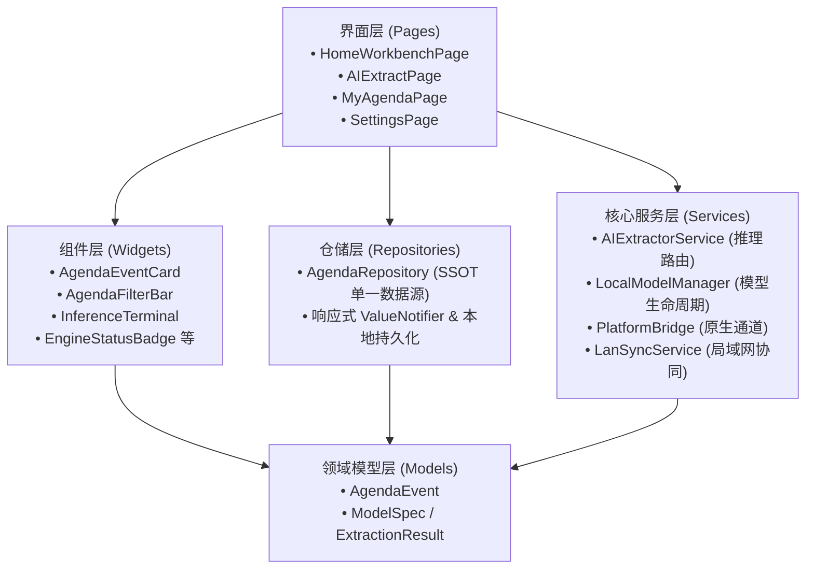

# 知程 Anno2Agenda - 模块化架构与接口规范总览

本文档定义了「知程 Anno2Agenda」端侧 AI 通知转日程系统的模块架构设计规范与接口契约（Interface Contracts）。  
旨在建立统一、清晰的代码边界与扩展约定，确保在后续引入新推理后端（如 ONNX/DirectML）、新数据存储（如 SQLite/云端同步）、新平台系统日历及第三方插件时，具备高度的模块独立性与低耦合拓展能力。

---

## 1. 系统分层架构与拓扑关系

项目严格遵循**分层架构（Layered Architecture）**与**依赖倒置原则（Dependency Inversion Principle）**，禁止反向逆向依赖与跨层隐式调用。

### 层次边界与职责定义

| 层次 (Layer) | 职责说明 | 依赖约束 |
| :--- | :--- | :--- |
| **`models/`** | 纯数据模型、实体属性定义、序列化/反序列化（JSON / RFC 5545 .ics）。 | **零外部依赖**。不依赖任何 UI、Widget、Service 或 Repository。 |
| **`repositories/`** | 单一真实数据源（SSOT）。负责日程数据的增删改查、排序、条件检索、文件持久化和数据变更响应式广播。 | 仅依赖 `models/` 与平台基础 I/O，不直接依赖 UI 组件。 |
| **`services/`** | 业务逻辑、底层原生桥接、本地 AI 推理引擎加载与通信协议。 | 依赖 `models/`，通过回调函数或 Stream 向调用方交付处理结果，不持有界面上下文。 |
| **`widgets/`** | 高复用性原子与复合 UI 组件。负责特定视图渲染与用户交互触发。 | 依赖 `models/`，仅通过属性（Props）输入数据，通过回调（Callbacks）向上冒泡事件。 |
| **`pages/`** | 完整业务视图。组装各 Widgets，接入 Repositories 和 Services，负责自适应布局调度。 | 可依赖所有下层模块，负责页面的状态持有与生命周期管理。 |

---

## 2. 接口契约文档索引

详细的各模块间契约定义请查阅以下专项规范文档：

1. [**数据模型契约规范 (`models_contract.md`)**](./models_contract.md)
   - `AgendaEvent` 属性约束、序列化协议及 RFC 5545 iCalendar 标准映射规范。
2. [**仓储层接口契约规范 (`repositories_contract.md`)**](./repositories_contract.md)
   - `AgendaRepository` 抽象规范、CRUD 契约、响应式订阅、冲突合并算法及持久化标准。
3. [**核心服务层契约规范 (`services_contract.md`)**](./services_contract.md)
   - `PlatformBridge` 原生通道契约（Android 悬浮窗/无障碍/日历）。
   - `AIExtractorService` 提取路由与打字机实时流回调规范。
   - `LocalModelManager` 端侧 GGUF 模型生命周期、显存预热与魔搭直链下载契约。
4. [**局域网协同与算力反哺协议规范 (`lan_protocol_spec.md`)**](./lan_protocol_spec.md)
   - HTTP REST 端口、`/ping`、`/sync`、`/extract` 报文结构与异常处理规约。
5. [**UI 组件与页面解耦契约规范 (`widgets_pages_contract.md`)**](./widgets_pages_contract.md)
   - UI 组件输入/输出标准化、响应式多端布局适配规范及弹窗扩展规范。

---

## 3. 开发者扩展指南 (Extension Guidelines)

### 3.1 扩展一个新的 AI 推理引擎后端 (如接入 DirectML 或云端 API)
1. 在 `AIExtractorService` 中扩充 `AIEngineMode` 枚举；
2. 实现对应的私有提取器方法 `_extractViaNewEngine()`，保持输入为 `String rawText`，输出为 `ExtractionResult`；
3. 支持 `onProgress` 进度流水线日志与流式 Token 回调，确保打字机终端无需修改即可实时展示；
4. 确保在主流程中保留异常捕获，自动降级至内置规则引擎。

### 3.2 替换数据持久化实现 (如迁移至 SQLite / Hive / Isar)
1. 继承或遵循 `IAgendaRepository` 接口约定；
2. 内部实现 `_persist()` 与 `init()` 的存储驱动切换；
3. 严格维护 `eventsNotifier` 的触发时机，界面层完全无感知即可完成存储引擎平滑升级。

### 3.3 扩展新的系统原生特性 (如 iOS 日历或 Windows Toast)
1. 在 Android/iOS/Windows 宿主工程的原生 MethodChannel 处理中注册新方法名；
2. 在 `PlatformBridge` 中封装类型安全的静态异步方法，返回标准 Dart 对象或布尔值；
3. 在非对应平台（如 Windows 上调用 Android 悬浮窗）必须提供安全降级（直接返回 false 或优雅提示），禁止抛出未捕获 MissingPluginException。
